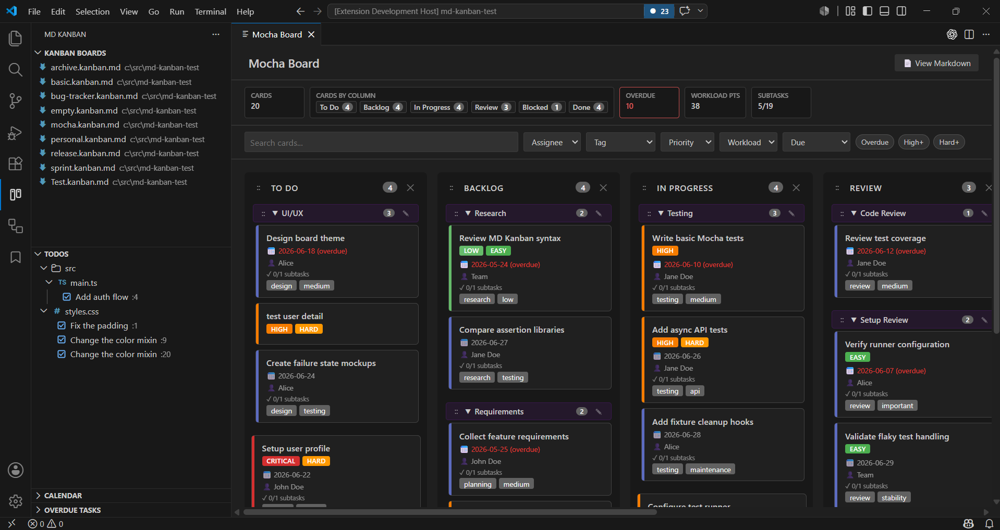
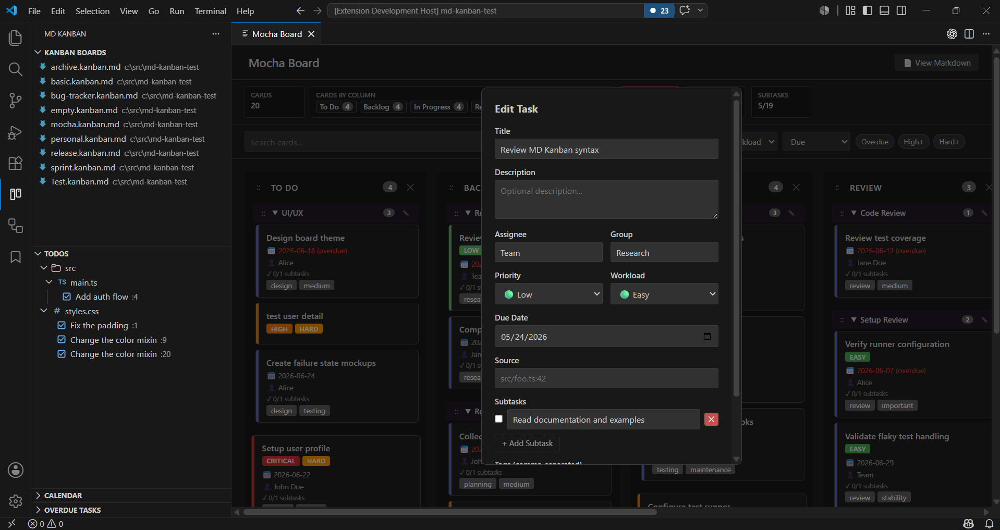
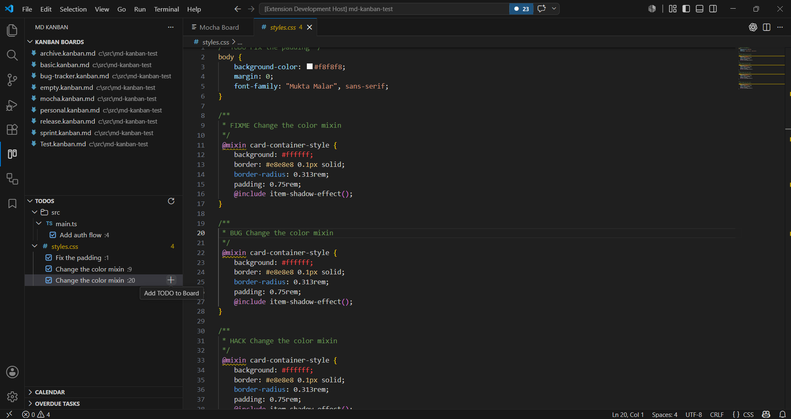
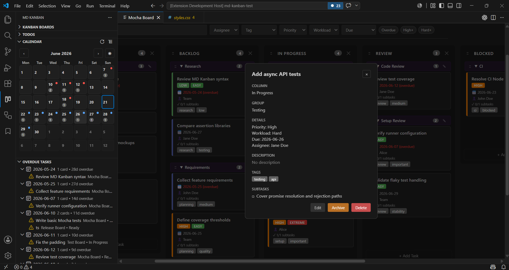
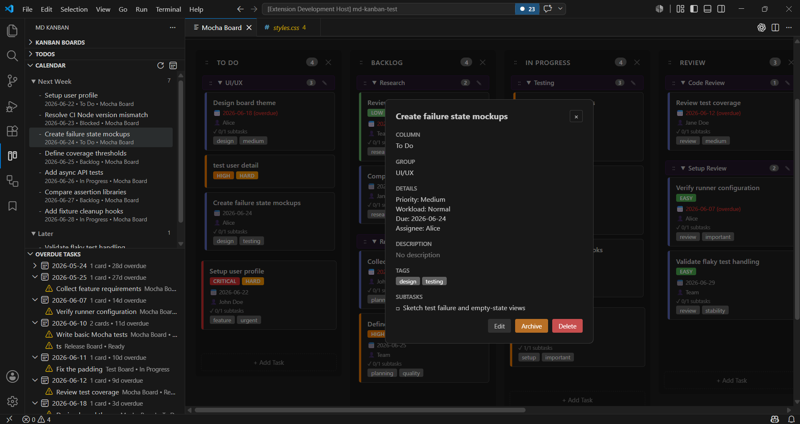

# MD Kanban JP

MD Kanban JP は、タスクを見やすいカンバンボードで管理しながら、データの本体はプレーンな Markdown に保つ VS Code 拡張機能です。

コードと一緒に置ける軽量なプロジェクトボードが欲しい、Git と相性よく使いたい、外部サービスに登録せず使いたい——そんなときに向いています。

> 本拡張機能は [jebakumarj/md-kanban](https://github.com/jebakumarj/md-kanban) を日本語化・汎用化したフォークです。


## スクリーンショット

### ボードビュー



### タスクの追加



### TODO ビュー



### カレンダー・期限超過ビュー



### タイムラインビュー



## MD Kanban JP の特長

- **ローカルファースト** — ボードはワークスペース内の `.kanban.md` / `kanban.md` ファイルに保存されます。
- **Git フレンドリー** — タスクは読みやすい Markdown なので、変更のレビュー・差分・バージョン管理ができます。
- **外部アカウント不要** — 別サービスにサインインせずにカンバンを使えます。
- **見た目でも、テキストでも** — ボードUIで編集しても、Markdown を直接開いても構いません。
- **エディタから離れない** — VS Code のアクティビティバーからボード・ソースTODO・期限超過カードを扱えます。

## 主な機能

- `.kanban.md` / `kanban.md` ファイル用のカンバンボードUI。
- ボード・TODO・期限超過タスク・カレンダーのセクションを持つアクティビティバービュー。
- 1ワークスペースに複数ボード。すべての `*.kanban.md` / `kanban.md` がサイドパネルに並びます。
- ボードテンプレート: 空のボード / 基本 / プロジェクト / チェックリスト / イベント・企画 / 個人用。
- カードのテキスト・担当者・タグ・優先度・作業量・期限日での絞り込みと検索。
- 統計バー(カード数、列ごとのカード数、期限超過、作業量ポイント、サブタスク進捗)。
- 期限超過タスクのサイドパネルビュー。
- カレンダーのサイドパネルビュー(月グリッド、日付ドット、件数、折りたたみ可能なタイムラインツリー)。
- カードを `archive.kanban.md` へ個別アーカイブし、元のボード・元の列へ復元。
- 元に戻す(Undo): ツールバーまたは `Ctrl+Z` で直前の変更を取り消し(アーカイブ・復元も対象)。
- 列内・列間・グループへの出入り・列末尾へのドラッグ&ドロップ。右ドラッグでボードをパン(スクロール)。
- 落下位置を示すドロップインジケーター。
- Markdown の `###` 見出しに対応する折りたたみ可能なタスクグループ。
- グループ名の変更(グループ内の全カードをまとめて更新)、グループごとのドラッグ移動。
- 列の追加・名前変更・削除。手動での並べ替え、または「常にこの順序を保つ」ソートルール(期限順 / 優先度順 / タイトル順)。
- タスク項目: 説明・タグ・優先度・作業量・開始日・期限日・担当者・サブタスク・繰り返し。
- クイック追加(タイトルだけで連続追加)と、カードから直接切り替えられるサブタスクのチェック。
- タグ入力の候補チップ、期限日のクイック設定(今日/明日/来週)、カード上の説明の表示切り替え。
- 繰り返しタスク: 完了扱いの列へ移動すると、期限日を繰り上げた次回分を自動作成。
- タスクごとの詳細ファイル: 専用の Markdown ファイルに書き込んでいけます。新規タスクには自動作成、既存タスクには後付けで作成可能。カード上に最終更新日、ホバーで内容のプレビューを表示。
- 完了日の自動記録(完了列への移動時)と所要日数の表示。期限が近いカードの段階的な色分け(今日 / 明日 / 1週間以内)。
- カードの複製、`Ctrl+クリック` による複数選択と一括操作(列移動・タグ追加・アーカイブ・削除)。
- 説明文中の URL・Markdown リンクをクリック可能なリンクとして表示。
- タスクテンプレート(会議・プロジェクト・用事など)でカードをすばやく作成。
- キーボード操作(カードのフォーカス移動・移動・保存・元に戻す)とショートカット一覧(`?`)。
- 設定したコメントキーワード(`TODO`、`FIXME`、`BUG`、`HACK`、`NOTE` など)を集めるエクスプローラ風の TODO ツリー。
- ソースTODOコメントを、ソースファイルと行の情報付きでカードとしてボードに追加。
- 優先度ストリップ、作業量バッジ、期限超過ハイライト、サブタスク進捗表示。
- VS Code テーマ連携。
- ボード外での変更を検知するファイルウォッチ。
- 生の Markdown を横に並べて表示。

## インストール

### VSIX から

パッケージ化した `.vsix` ファイルがある場合:

1. VS Code を開く。
2. **拡張機能: VSIX からのインストール...** を実行。
3. `.vsix` ファイルを選択。

### ソースから

[開発セットアップ](#開発セットアップ)を参照してください。

## クイックスタート

1. アクティビティバーの **MD Kanban JP** アイコンを開く。
2. **カンバンボード** セクションで **新しいカンバンボードを作成** をクリック。
3. ボード名を入力し、テンプレートを選択。ワークスペースに `.kanban.md` ファイルが作成されます。
4. サイドパネルのボードをクリックして開く。
5. タスクを追加し、カードをドラッグして動かす。

| コマンド | 説明 |
| --- | --- |
| `カンバン: 新しいカンバンボードを作成` | テンプレートから新しい `.kanban.md` を作成 |
| `カンバン: カンバンボードを開く` | 既存のボードファイルを選んで開く |
| `カンバン: カンバンボードを更新` | サイドパネルのボード一覧を更新 |
| `カンバン: TODOを更新` | サイドパネルのソースTODO一覧を更新 |
| `カンバン: 期限超過タスクを表示` | 期限超過タスクビューにフォーカス |
| `カンバン: 期限超過タスクを更新` | 期限超過カードを更新 |
| `カンバン: タイムラインを表示` | カレンダービュー内のタイムラインツリーを表示 |
| `カンバン: タイムラインを更新` | タイムラインの今後の期限カードを更新 |
| `カンバン: カレンダーを表示` | カレンダービューにフォーカス |
| `カンバン: カレンダーを更新` | 日付付きカードを更新 |

1ワークスペースに複数のボードを置けます。`frontend.kanban.md`、`backend.kanban.md` などは別々のボードとして一覧に表示されます。

ボードファイルはエクスプローラやエディタタブの右クリックメニューにも **カンバンボードを開く** アクションがあります。TODO 項目には TODO サイドパネル内にインラインの追加アイコンがあります。

## ボードの使い方

### タスク

- 列内の **+ タスクを追加** でクイック追加の入力欄が開きます。タイトルを入力して `Enter` を押すと追加され、続けて次のカードを入力できます。`Escape` で閉じます。
- クイック追加の **詳細入力** を押すと、説明・期限・サブタスクなどを入力する画面に切り替わります(入力済みのタイトルは引き継がれます)。
- タスクテンプレートを選ぶと、タイトル・タグ・優先度・作業量・担当者・サブタスクがあらかじめ入ります。
- カードをクリックすると編集画面が直接開きます。編集画面の左下に **削除** と **アーカイブ**(対応ボードのみ)ボタンがあります。
- カード上のサブタスク進捗(`✓ 1/3 サブタスク`)をクリックすると一覧が開き、**チェックボックスをその場で切り替え**られます。
- 説明文に URL や Markdown リンクを書くとリンクになります(→ [説明文のリンクと作業詳細の記録](#説明文のリンクと作業詳細の記録))。
- **タスクごとの詳細ファイル**: 新しく作成したタスクには、詳細を書き込める専用の Markdown ファイルが自動的に作られます(→ [タスクごとの詳細ファイル](#タスクごとの詳細ファイル))。カード上の **📝 詳細ファイルを開く** リンク、または編集画面上部のリンクから開けます。
- 編集画面のタグ欄の下に、**そのボードで使用中のタグが候補として表示**されます。クリックで追加/削除でき、入力中は入力内容で候補が絞り込まれます。表記のゆれを防げます。
- **説明の表示切り替え**: ツールバーの **📝 説明** ボタンで、カード上の説明を表示するかどうかを切り替えられます。表示中でも長い説明は3行で省略され、カードごとに **▾ 続きを表示 / ▴ 折りたたむ** で個別に開閉できます(状態は保持されます)。
- **開始日**: 新しく作ったカードには作成日が開始日として自動的に入ります。編集画面の **開始日** 欄でいつでも変更でき、**クリア** で空にもできます。
  - カードには開始日と期限日が `📅 2026-07-23 → 2026-07-30` のように表示されます(開始日のみの場合は `▶ 2026-07-23`)。
- 編集画面の期限日には **今日 / 明日 / 来週 / クリア** のクイック設定ボタンがあります。
- **期限が近いカードの色分け**: 期限日の表示は、期限超過が赤、**今日まで** がオレンジの強調、**明日まで** がオレンジ、**1週間以内**(`あとN日`)が黄色になります。完了列のカードや完了日のあるカードには警告を出しません。
- **完了日の自動記録**: カードを完了扱いの列(設定 `mdKanbanJp.completedColumnGlobs`、既定は「完了」「クローズ」など)へ移動すると、その日付が `<!-- done: YYYY-MM-DD -->` として記録され、カードに `✅ 2026-11-24 完了(所要4日)` のように表示されます(所要日数は開始日がある場合)。完了列から戻すと完了日は消えます。完了列同士の移動や復元では元の完了日が保たれます。
- **カードの複製**: 編集画面またはカード詳細の **⧉ 複製** で、同じ内容のカードがすぐ下に「〇〇 のコピー」として作られ、そのまま編集画面が開きます。サブタスクは未完了に戻り、開始日は今日になります。元のカードに詳細ファイルがあれば、複製側にも新しい(空の)詳細ファイルが作られます。
- **複数選択と一括操作**: `Ctrl+クリック`(Mac は `Cmd+クリック`)、またはフォーカス中のカードで `Ctrl+Space` を押すとカードを選択できます。選択中は画面下部にバーが表示され、**列へ移動 / タグを追加 / アーカイブ / 削除** をまとめて実行できます。`Escape` または **選択解除** で選択を解除します。一括操作も **↩ 元に戻す** で1回で取り消せます。
- 編集画面の **繰り返し**(毎日 / 毎週 / 毎月 / 毎年)を設定したカードは、完了扱いの列へ移動すると次回分が元の列に自動作成されます(期限日は繰り上がり、サブタスクは未完了に戻ります)。カードには 🔁 バッジが表示されます。
- 列見出しの **⇅** ボタンで、その列を **期限順 / 優先度順 / タイトル順** に並べ替えられます(グループはまとまりを保ったまま、グループ内が並べ替えられます)。
  - 既定では「**常にこの順序を保つ**」が有効で、カードを追加・編集・移動しても列は自動的にその順序に並び直されます(新しく追加したカードが末尾に残ることはありません)。ルールが付いた列は見出しに `⇅ 期限順` のように表示されます。
  - ルールは Markdown に `<!-- sort: due -->` として保存されるので、ファイルを開き直しても保たれます。
  - 一度だけ並べ替えたい場合はチェックを外してから順序を選びます。ルールを外すには ⇅ から **自動並べ替えを解除** を押します(その時点の並びは保持されます)。
- ツールバーの **↩ 元に戻す**(または `Ctrl+Z`)で直前の変更を取り消せます。アーカイブや復元も取り消せます。
- 削除・アーカイブは確認ダイアログを挟み、その操作について「今後確認しない」を選べます。
  - 詳細ファイルを持つカードの削除時は、確認ダイアログの **詳細ファイルもゴミ箱に移動する** にチェックを入れると、紐づく詳細ファイルも OS のゴミ箱へ移動します(既定はオフ。「今後確認しない」にした場合は削除しません)。
- カードにマウスを重ねると、編集・アーカイブ・削除・ソースを開く のクイックボタンが右上に表示されます。
- ソース情報を持つカードは、参照先のファイルと行を開くソースボタンを表示します(ソース情報は TODO からのカード化時に付与され、編集しても保持されます)。
- カードをドラッグして並べ替えたり、列やグループの間を移動できます。
- 青い破線のドロップインジケーターで落下位置を確認できます。
- **ボード上を右ドラッグすると画面をパン**(縦横スクロール)できます。列が多いボードで便利です。
  - パン操作に右ボタンを使うため、ボード上では右クリックメニューは表示されません。入力欄では通常どおり表示されます。

### 説明文のリンクと作業詳細の記録

カードの説明文に書いた URL や Markdown リンクは、そのままクリックできるリンクになります。
説明欄に収まらない**作業の詳細は別の Markdown ファイルに書き、カードからはリンクで参照する**という使い方ができます。

#### 書き方

````markdown
実装方針は [設計メモ](docs/design.md) を参照。
前回の議論は [議事録](notes/2026-07-22.md:15) の15行目から。
仕様は [公式ドキュメント](https://example.com/docs) にあります。
````

| 書き方 | 動作 |
| --- | --- |
| `[表示名](パス)` | ワークスペース内のファイルをエディタで開く(ボードの横に表示) |
| `[表示名](パス:行番号)` | そのファイルの指定行を開く |
| `[表示名](https://...)` | 既定のブラウザで開く |
| `https://...`(裸のURL) | 既定のブラウザで開く |

#### パスの解決ルール

相対パスは次の順で探し、最初に見つかったファイルを開きます。

1. **ボードファイルからの相対**(Markdown リンク本来の解釈)
2. **ワークスペースのルートからの相対**

例えば `docs/plan.kanban.md` というボードで `[メモ](notes/memo.md)` と書いた場合、
まず `docs/notes/memo.md` を探し、無ければ `notes/memo.md` を探します。絶対パスもそのまま使えます。

見つからない場合は「リンク先のファイルが見つかりませんでした」と通知されます。

#### 運用例

作業ごとに詳細ノートを用意して、カードから参照する形にすると、ボードは一覧性を保ったまま情報を蓄積できます。

````text
project.kanban.md          ← ボード(カードには要約とリンクだけ)
notes/
  api-refactor.md          ← [詳細](notes/api-refactor.md) からリンク
  2026-07-22-meeting.md    ← [議事録](notes/2026-07-22-meeting.md) からリンク
````

ノートも Markdown なので、ボードと一緒に Git で差分管理できます。

> セキュリティ上の注意: 説明文は常にテキストとして描画され、HTML としては解釈されません。
> リンク先として開けるのは `file` / `vscode-remote` / `vscode-vfs` / `untitled` のファイルと、`http(s)` の Web ページのみです。

### タスクごとの詳細ファイル

上記の「作業ごとに詳細ノートを用意してリンクする」運用を、**新しく作ったタスクでは自動化**しています。

- タスクを追加すると、ボードファイルと同じフォルダに **`<ボード名>.tasks/`** フォルダが作られ、その中に **`<タスク名>.md`** というタスク専用の Markdown ファイルが自動的に作成されます([Foam](https://foambubble.github.io/foam/) などのノートと同じく、ファイル名 = ノート名で `[[タスク名]]` のように参照できます)。
  - 例: `project.kanban.md` のタスク「企画書を作成」なら `project.tasks/企画書を作成.md`。
  - ファイル名に使えない文字(`/ \ : * ? " < > |`)や、Foam のリンクと衝突する `# ^ [ ]` は空白に置き換えます。長いタイトルは80文字で切り詰めます。
  - 同じ名前のファイルが既にある場合は上書きせず、`企画書を作成 (2).md` のように番号を付けます。
  - `kanban.md` / `.kanban.md` という名前のボードでは、フォルダ名は `kanban.tasks` / `.kanban.tasks` になります。
- カード上の **📝 詳細ファイルを開く**(編集画面を開いたときは上部にも同じリンクがあります)をクリックすると、そのファイルがエディタでボードの横に開きます。
- カード上のリンクの横には `· 3日前に更新` のように**最終更新日**が表示され(まだ見出ししかないときは `· 未記入`)、その行にマウスを重ねると**ファイルの冒頭がプレビュー**されます。カードをクリックして開く詳細モーダルにも冒頭部分が表示されます。ファイルを編集すると自動的に反映されます。
- ファイルの中身は自由に書いて構いません。先頭に Foam などで使える YAML フロントマター(`kanban-id` / `tags` / `created` / `board`)とタスク名の見出しを入れておくだけで、他には何も強制しません。進捗メモ、調査ログ、チェックリストなど、書きながら育てていけます。

  ```markdown
  ---
  kanban-id: task-1770000000000-0
  tags: [仕事, 企画]
  created: 2026-11-24
  board: project.kanban.md
  ---

  # 企画書を作成
  ```

  フロントマターが不要な場合は設定 `mdKanbanJp.detailsFrontmatter` を `false` にしてください(見出しと末尾の `<!-- kanban-id: … -->` だけのファイルになります)。タグは作成時点のものが入ります(空白は `-` に置き換え)。
- **リンクの仕組み**: ボードは `<!-- details: パス -->` でファイルの場所を覚えています。拡張機能が行うリネーム・移動(番号付けを含む)ではこのパスを自動で書き換えるので、リンクは崩れません。
  - エクスプローラーや Foam 側でファイルを**手で移動・リネームした場合**も、ファイルの `kanban-id`(タスクID)を手がかりに見つけ直してリンクを自動修復します。`<ボード名>.tasks/` とナレッジフォルダ(下記)は自動で探し、それ以外の場所へ移したファイルはカードのリンクをクリックしたときにワークスペース全体から探します。
  - `kanban-id` を消したり書き換えたりすると見つけ直せなくなるので、そのまま残しておいてください。
- **タスク名を変えるとファイル名も追従**します。VS Code の「名前の変更」として実行するため、Foam の「ファイル名変更時にリンクを更新」機能が有効なら、他のノートの `[[旧タスク名]]` も更新されます。手動で別の名前に変えたファイルは、タスク名を変えても名前を変えません。
- **完了したら Foam のナレッジフォルダへ移動**: 設定 `mdKanbanJp.completedDetailsFolder` にワークスペースルートからのフォルダ(例: `notes/done`)を指定すると、カードを完了扱いの列へ移動したときに詳細ファイルがそのフォルダへ移動し、ボードのリンクも更新されます。完了列から戻してもファイルはナレッジフォルダに残ります。
- ファイル名の変更・移動は、**↩ 元に戻す**(`Ctrl+Z`)で元に戻せます。
- 以前の版で作られた `task-xxxx.md` のような ID 名のファイルは、コマンドパレットの **カンバン: 詳細ファイル名をタスク名に揃える** で一括でタスク名に変更できます(最後に操作していたボードが対象。実行前に確認があります)。このとき、`kanban-id` が記録されていないファイルにはフロントマターへ追記します。
- カード側の **説明** 欄(タイトル下の短い説明)は従来どおり残っています。詳細ファイルは「書き込んでいく長文のメモ」のためのもので、両者は役割が別です。
- まだ詳細ファイルを持たないタスク(この機能より前に作ったタスクなど)は、カード詳細モーダルや編集画面に表示される **📝 詳細ファイルを作成** ボタンから、いつでも後付けで作成できます。作成すると自動的にエディタで開きます。

#### 注意点

- 新しく作成したタスクには自動的に、既存タスクには **📝 詳細ファイルを作成** ボタンを押したときに作成されます。既存タスクの説明文が自動で移動したり書き換えられることはありません。
- 作成先に同じ名前のファイルが既にある場合は、上書きせずに番号付きの別名で作成します。既存のメモが消えることはありません。
- タスクを削除しても、紐づく詳細ファイルは**既定では削除されません**。削除の確認ダイアログで **詳細ファイルもゴミ箱に移動する** にチェックを入れたときだけ、OS のゴミ箱へ移動します(元に戻す でカードを戻してもファイルは戻らないので、必要ならゴミ箱から復元してください)。対象はそのボードの `<ボード名>.tasks/` フォルダ直下のファイルだけで、ナレッジフォルダへ移動済みのファイルは削除しません。
- アーカイブ・復元では詳細ファイルへのリンクはそのまま保たれます(ファイル自体は元のボードのフォルダに残ります)。
- 詳細ファイルの作成に失敗した場合(読み取り専用のワークスペースなど)でも、タスク自体の追加は失敗しません。通知でお知らせします。
- `archive.kanban.md` 内のカードには詳細ファイルを作成できません。

### キーボード操作

マウスを使わずにカードを操作できます。カードは Tab でフォーカスできます。

| キー | 操作 |
| --- | --- |
| `Enter` / `Space` | フォーカス中のカードの編集画面を開く |
| `Ctrl+Enter`(Mac は `Cmd+Enter`) | 編集画面で保存 |
| `Escape` | モーダルを閉じる / カードの選択を解除 |
| `Ctrl+クリック` / `Ctrl+Space` | カードを選択(複数選択して一括操作) |
| `↑` / `↓` | 同じ列の前後のカードへフォーカス移動 |
| `←` / `→` | 隣の列のカードへフォーカス移動 |
| `Ctrl+↑` / `Ctrl+↓` | フォーカス中のカードを列内で並べ替え |
| `Ctrl+←` / `Ctrl+→` | フォーカス中のカードを隣の列へ移動 |
| `n` | フォーカス中のカードの列にクイック追加(`Enter` で連続追加) |
| `Ctrl+Z` | 直前の操作を元に戻す |
| `?` | キーボードショートカット一覧を表示 |

ツールバーの **⌨ ショートカット** ボタンからも一覧を開けます。

### 統計と絞り込み

- 統計バーで、総カード数・列ごとの件数チップ・期限超過・作業量ポイント・完了サブタスクを一目で把握できます。
- 作業量ポイントは見積もりの目安です: 簡単 = 1、普通 = 2、難しい = 3、非常に困難 = 5。
- 絞り込みバーでカードのテキスト検索と、担当者・タグ・優先度・作業量・期限での絞り込みができます。
- 「期限超過」「高優先度以上」「高負荷以上」のクイックチップがあります。
- 「クリア」で絞り込みを解除して全体表示に戻ります。

### 期限超過タスク

- **期限超過タスク** ビューは、期限超過カードを期限日ごとにまとめて表示します。
- カードの `due` が今日より前だと期限超過になります。
- 完了扱いの列はスキップされます。既定の完了列パターンは `完了`、`クローズ`、`リリース済み`、`アーカイブ済み`、`Done`、`Closed`、`Shipped`、`Archived` です。
- 完了列名のパターンは `mdKanbanJp.completedColumnGlobs` で設定できます(`*` と `?` のワイルドカード対応)。
- 期限超過カードをクリックすると、そのカンバンボードを開いてカードの詳細を表示します。

設定例:

```json
{
  "mdKanbanJp.completedColumnGlobs": ["完了", "クローズ", "Done", "リリース済み *"]
}
```

プロジェクトに `.vscode/settings.json` を追加してください。

### カレンダー

- **カレンダー** ビューは日付付きの月グリッドを表示します。
- 日付セルには日付・ドット・件数を表示し、期限超過を含む日は警告色のドットになります。
- 日付セルをクリックすると、その日の最初のカードをカンバンボードで開いて詳細を表示します。
- 前月・次月・今日(丸アイコン)ボタンで月を移動できます。
- 更新の隣の切り替えボタンで、カレンダーとタイムラインを切り替えられます。
- タイムラインは今後のカードを `今日` / `今週` / `来週` / `今後` の折りたたみグループで表示します。
- `今週` と `来週` は月曜始まりのカレンダー週です。
- 期限超過カードはタイムラインではなく **期限超過タスク** ビューに残ります。
- 完了扱いの列は、期限超過・タイムラインと同じ `mdKanbanJp.completedColumnGlobs` 設定でスキップされます。

### グループ

- `###` 見出しの下のタスクはそのグループに属します。
- グループヘッダーをクリックで折りたたみ/展開します。
- グループの編集アイコンで名前を変更します。
- グループのドラッグハンドル(`::`)でグループごと移動します。
- カードをグループにドロップすると割り当てられます。
- 未グループ領域や列末尾にドロップするとグループから外れます。

### 列

- ボード作成時にテンプレート(空のボード / 基本 / プロジェクト / チェックリスト / イベント・企画 / 個人用)を選びます。
- 「空のボード」は列のない空のボードを作成します。**+ 列を追加** で自分で組み立てます。
- **+ 列を追加** で列を作成します。
- 列タイトルをクリックで名前を変更します。
- 列のドラッグハンドル(`::`)で並べ替えます。
- 削除アイコンで列とそのタスクを削除します。

### 既定のテンプレート

ボードテンプレートは新しい `.kanban.md` の初期列を定義します:

| テンプレート | 既定の列 |
| --- | --- |
| 空のボード | 列なし |
| 基本 | `未着手`、`進行中`、`完了` |
| プロジェクト | `バックログ`、`計画中`、`進行中`、`レビュー`、`完了` |
| チェックリスト | `未対応`、`対応中`、`確認待ち`、`完了` |
| イベント・企画 | `アイデア`、`準備中`、`実施待ち`、`完了` |
| 個人用 | `今日`、`今週`、`保留中`、`完了` |

タスクテンプレートはカード追加時に共通項目をあらかじめ入力します:

| テンプレート | タイトル | タグ | 優先度 | 作業量 | 既定のサブタスク |
| --- | --- | --- | --- | --- | --- |
| 空白 | なし | なし | `medium` | `normal` | なし |
| 会議 | `会議` | `会議` | `medium` | `easy` | アジェンダを準備する / 議事録を取る / 決定事項とToDoを共有する |
| プロジェクト | `プロジェクト項目` | `プロジェクト` | `medium` | `hard` | ゴールを定義する / 作業を分解する / 期限と担当を決める |
| 用事 | `用事` | `用事` | `medium` | `easy` | 必要なものを準備する / 実行する |
| 個人 | `個人タスク` | `personal` | `medium` | `easy` | 次のアクションを決める |

### Markdown ビュー

- **Markdownを表示** で、ボードファイルの生テキストをボードの横に開きます。
- Markdown を手で編集すると、ファイル変更を検知してボードに反映されます。

### アーカイブ

- カードやカードのクイックボタンのアーカイブから、そのカードを `archive.kanban.md` へ移動します。
- ボードの隣に `archive.kanban.md` が無ければ自動作成します。
- 既にあれば追記更新します。
- アーカイブされたカードは、元ボードのファイル名(例 `plan.kanban.md`)を名前にした列に追加されます。
- アーカイブ後、元ボードからそのカードは取り除かれます。
- `archive.kanban.md` 内のカードは再アーカイブできません。代わりに **⇧ 復元** ボタン(カードのクイックボタン、または編集画面の「復元」)で元のボードに戻せます。
- 復元先は、アーカイブ時にいた列(`<!-- archivedFrom: 列名 -->` として記録)です。その列が無い場合は先頭の列に戻ります。

### TODO

- サイドパネルの **TODO** セクションは、設定したコメントキーワードをワークスペースから収集します。
- TODO はフォルダとファイルでまとめられ、エクスプローラのように展開・折りたたみできます。
- TODO 項目をクリックすると、該当行でソースファイルを開きます。
- 追加アイコンをクリックすると、カンバンカードとして追加できます。
- 対象ボードと列を選ぶと、TODO のタイトル・`todo` タグ・`source` メタデータ・バックリンク・元のTODOテキストを持つカードが作られます。
- TODO は `.kanban.md` ボードとは別です。元のソースコメントを編集・削除して更新します。
- 対象ファイルとキーワードは `mdKanbanJp.todoInclude`、`mdKanbanJp.todoExclude`、`mdKanbanJp.todoKeywords` で設定します。

対応する TODO コメントの書き方:

```ts
// TODO バリデーションを追加
// FIXME リトライ失敗の処理
// BUG フィルタリセット後の合計が誤り
// HACK 一時的なパーサのフォールバックを削除
// NOTE リリースチェックリストを記載
/* TODO バリデーションを追加 */
/**
 * TODO バリデーションを追加
 */
```

プロジェクトごとにスキャンを制御するには `.vscode/settings.json` を追加します:

```json
{
  "mdKanbanJp.todoKeywords": ["TODO", "FIXME", "BUG"],
  "mdKanbanJp.todoExclude": [
    "**/dist/**",
    "**/node_modules/**",
    "**/generated/**"
  ],
  "mdKanbanJp.todoInclude": [
    "src/**/*.ts",
    "tests/**/*.ts"
  ],
  "mdKanbanJp.completedColumnGlobs": [
    "完了",
    "クローズ",
    "リリース済み *"
  ],
  "mdKanbanJp.completedDetailsFolder": "notes/done",
  "mdKanbanJp.detailsFrontmatter": true
}
```

ワークスペース設定はそのプロジェクトにのみ適用され、ユーザーレベルの既定を上書きします。

## Markdown フォーマット

ボードデータはプレーンな Markdown に保存されます。手動でもボードUIでも編集できます。

```markdown
# マイプロジェクトボード

## 未着手
<!-- sort: due -->

#### データベースマイグレーションを整備
<!-- id: task-1770000000000-0 -->
PostgreSQL のスキーマ変更用のマイグレーションスクリプトを作成する。
- [x] スキーマ設計
- [ ] マイグレーションファイル作成
- [ ] ロールバックスクリプト追加
Tags: `backend` `database`
<!-- priority: high -->
<!-- workload: hard -->
<!-- start: 2026-03-20 -->
<!-- due: 2026-04-01 -->
<!-- assignee: 田中 -->
<!-- source: src/db/migrations.ts:42 -->
<!-- details: マイプロジェクト.tasks/データベースマイグレーションを整備.md -->

### スプリント1

#### ユーザー認証を実装
<!-- id: task-1770000000000-1 -->
Google と GitHub の OAuth2 対応を追加する。
Tags: `feature` `auth`
<!-- priority: critical -->
<!-- assignee: 鈴木 -->
<!-- repeat: weekly -->

#### グループ後の未グループタスク
<!-- id: task-1770000000000-2 -->
<!-- group: -->
グループ見出しの後にあっても、明示的に未グループのタスクです。
```

### 見出し

| 見出し | 意味 |
| --- | --- |
| `#` | ボードタイトル |
| `##` | 列 |
| `###` | タスクグループ |
| `####` | タスク |

### ボードメタデータ

ボード全体のメタデータはファイル先頭付近の HTML コメントに保存されます。

| コメント | 値 |
| --- | --- |
| `<!-- empty-board: true -->` | 列のない空のボードを空のまま保つ |

### 列メタデータ

列の見出し(`##`)の直下の HTML コメントに保存されます。

| コメント | 値 |
| --- | --- |
| `<!-- sort: VALUE -->` | `due`(期限順)、`priority`(優先度順)、`title`(タイトル順)。列を常にこの順序に保つ |

### タスクメタデータ

メタデータはタスクの下の HTML コメントに保存されます。

| コメント | 値 |
| --- | --- |
| `<!-- id: VALUE -->` | MD Kanban JP が生成する安定したタスクID |
| `<!-- priority: VALUE -->` | `critical`, `high`, `medium`, `low` |
| `<!-- workload: VALUE -->` | `easy`, `normal`, `hard`, `extreme` |
| `<!-- start: YYYY-MM-DD -->` | 開始日(新規カードには作成日が入る) |
| `<!-- due: YYYY-MM-DD -->` | 有効な日付 |
| `<!-- done: YYYY-MM-DD -->` | 完了日(完了扱いの列へ移動したときに自動記録) |
| `<!-- assignee: NAME -->` | 自由テキスト |
| `<!-- source: PATH:LINE -->` | ソースファイルと行(例 `src/foo.ts:42`) |
| `<!-- details: PATH -->` | タスクの詳細ファイルへの相対パス(新規タスクで自動設定、→ [タスクごとの詳細ファイル](#タスクごとの詳細ファイル)) |
| `<!-- group: NAME -->` | 明示的なグループ割り当て |
| `<!-- group: -->` | 明示的に未グループとする |
| `<!-- repeat: VALUE -->` | `daily`, `weekly`, `monthly`, `yearly` |
| `<!-- archivedFrom: 列名 -->` | アーカイブ元の列(復元先の決定に使用) |

その他のタスク内容:

- **説明**: タスク見出しの下のプレーンテキスト。
- **サブタスク**: `- [x] 完了項目` / `- [ ] 未完了項目`。
- **タグ**: `Tags: \`tag-name\` \`another-tag\``。

## プライバシー

MD Kanban JP はボードデータをワークスペース内のローカル Markdown ファイルに保存します。アカウントは不要で、タスクデータを外部サービスへ送信することはありません。

## コントリビュート

貢献を歓迎します。バグやアイデアがあれば、リポジトリで Issue または Pull Request を作成してください。

### 開発セットアップ

```bash
git clone https://github.com/dancho0301/md-kanban-jpcustom.git
cd md-kanban-jpcustom
npm install
npm run compile
```

VS Code で **F5** を押すと拡張機能開発ホストが起動します。

テストの実行:

```bash
npm test
```

## 動作要件

- VS Code 1.109 以降。
- ローカル開発には Node.js 16 以降。

## ライセンス

MIT

オリジナル: [jebakumarj/md-kanban](https://github.com/jebakumarj/md-kanban)(Codex との共同制作)
